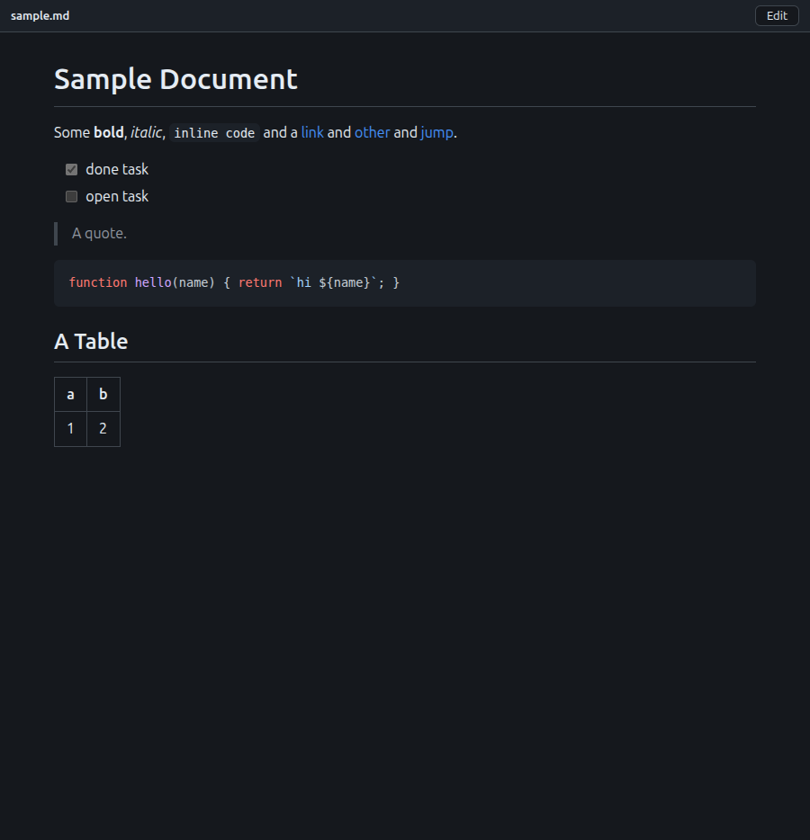
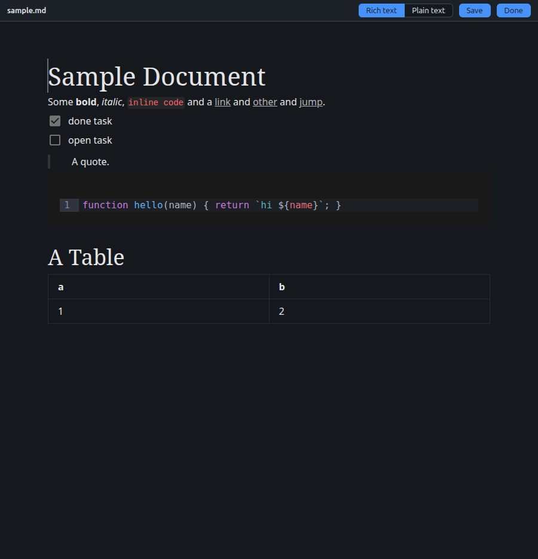

<p align="center"></p>

<h1 align="center">mdview</h1>

<p align="center">A clean Markdown viewer and editor for the Linux desktop.</p>

<p align="center">
  <a href="https://github.com/haystack-meme/mdview/releases/latest">Download</a> ·
  <a href="CHANGELOG.md">Changelog</a> ·
  <a href="https://github.com/haystack-meme/mdview/issues">Issues</a>
</p>

| View mode | Edit mode (rich text) |
|---|---|
|  |  |

## Features

- **Reads first.** Files open in view mode: GitHub-style Markdown (tables, task lists, strikethrough) with syntax-highlighted code, following your system's light/dark theme.
- **Edit when you want to.** Press **Edit** (Ctrl+E) to edit that one document. You can switch between a **rich-text** editor (Ctrl+1) and a **plain-text** editor (Ctrl+2) at any time. **Done** goes back to view mode.
- **One window per file.** No tabs. Opening a file that's already open brings its window forward.
- **Safe saving.** Ctrl+S saves. Closing a window with unsaved changes asks first.
- **Live reload.** If another program changes the file, view mode updates automatically. With unsaved edits, mdview asks before reloading.
- **Sensible links.** `.md` links open in a new window, web links in your browser, and other files in their default app.

## Install

Download from the [latest release](https://github.com/haystack-meme/mdview/releases/latest).

**Debian / Ubuntu (.deb):** recommended. It registers mdview as a handler for `.md` files.

```sh
sudo apt install ./mdview-*-amd64.deb
```

**AppImage**: runs on most distros, no install needed.

```sh
chmod +x mdview-*-x86_64.AppImage
./mdview-*-x86_64.AppImage notes.md
```

AppImages need FUSE 2 (`sudo apt install libfuse2t64` on Ubuntu 24.04+). Without it, run the AppImage with `--appimage-extract-and-run`.

**tar.gz**: unpack anywhere and run `./mdview`.

To make mdview your default app for Markdown files:

```sh
xdg-mime default mdview.desktop text/markdown
```

## Usage

```sh
mdview                 # new, untitled document
mdview README.md       # open a file
mdview a.md b.md       # one window each
```

| Keys | Action |
|---|---|
| Ctrl+E | Toggle edit mode |
| Ctrl+1 / Ctrl+2 | Rich-text / plain-text editor |
| Ctrl+S / Ctrl+Shift+S | Save / Save As |
| Ctrl+N / Ctrl+O | New window / Open file(s) |
| Ctrl+W | Close window |
| Ctrl+= / Ctrl+- / Ctrl+0 | Zoom in / out / reset |

In the rich editor, Ctrl+click follows a link.

> **Note:** once you edit in the rich editor, it rewrites Markdown in its own normalized style, for example table divider rows and escaping. List bullets keep your style. If exact formatting matters, use the plain-text editor.

## Development

Requires Node.js 22+.

```sh
npm install
npm start              # build and launch
npx electron . file.md # launch on a file (after a build)
npm run typecheck
npm run dist           # build AppImage, .deb and tar.gz into release/
```

On Ubuntu, Electron's dev binary needs its sandbox helper to be setuid root, or it aborts with *"The SUID sandbox helper binary was found, but is not configured correctly"*. Run `npm run fix-sandbox` once after `npm install` (it uses sudo).

| Path | What |
|---|---|
| `src/main/main.ts` | Main process: windows, menu, file I/O and watching, single instance, links |
| `src/main/preload.ts` | `window.mdview` IPC bridge (context isolation, sandboxed renderer) |
| `src/renderer/` | UI: viewer (marked + highlight.js + DOMPurify), rich editor (Milkdown Crepe), plain editor |
| `build/` | App icon (`icon.svg` source; `npm run render-icon` regenerates `icon.png`) |

### Releasing

Bump `version` in `package.json`, update `CHANGELOG.md`, then tag and push:

```sh
git tag v0.2.0 && git push origin v0.2.0
```

The release workflow builds the packages and publishes them to a GitHub release.

## License

[MIT](LICENSE)
